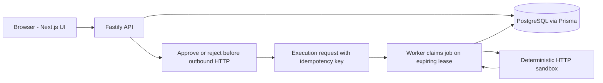

# Full-Stack AI Operations Console

[](https://github.com/naraya07pedro-spec/fullstack-ai-operations-console/actions/workflows/verify.yml)
[](https://nodejs.org/)
[](https://www.typescriptlang.org/)

An operations workspace for defining workflows, approving requests, executing an HTTP integration, and investigating failures. Next.js/React/TypeScript provide the interface; Fastify exposes the API; Prisma persists records in PostgreSQL; a separate worker owns execution.

The integration is an explicit **deterministic sandbox** for support-request classification and synthetic ticket creation. There is no live LLM, customer data, or claimed business ROI. This project demonstrates the application and operational controls around a provider boundary.

## Review in 60 seconds

**See the running UI evidence first:** [portfolio showcase](https://evannaraya.netlify.app/#operations-console) · [authentic dashboard screenshot](https://github.com/naraya07pedro-spec/evan-naraya-portfolio/blob/main/assets/projects/operations-console/dashboard.png) · [recorded Docker workflow demo](https://github.com/naraya07pedro-spec/evan-naraya-portfolio/blob/main/assets/projects/operations-console/workflow-demo.mp4).

**Follow an engineering decision:** [architecture](docs/ARCHITECTURE.md) → [versioned state and approval flow](docs/DECISIONS.md) → [failure-path tests](tests/integration/system.test.ts) → [known limitations](docs/KNOWN_LIMITATIONS.md).

**Executed verification:** [final reviewed CI run](https://github.com/naraya07pedro-spec/fullstack-ai-operations-console/actions/runs/38337575725) at `654ce3b762f45a126ff844604daf0d830e54bf21`: 58 system checks; 10 native browser cases; 10 Docker browser cases; 10 Docker HTTP smoke checks. This is a specific tested revision, not a claim that all later revisions or a hosted application passed.


## Review

[Evidence index](docs/EVIDENCE.md) · [Case study](docs/PORTFOLIO_CASE_STUDY.md) · [Architecture](docs/ARCHITECTURE.md) · [API](docs/API.md) · [Decisions](docs/DECISIONS.md) · [Container setup and release boundary](docs/DEPLOYMENT.md) · [Limitations](docs/KNOWN_LIMITATIONS.md)

## System diagram



## Behavior

- Persisted cookie sessions, revocation/expiry, operator/viewer permissions, and owner-scoped records.
- Workflow CRUD with optimistic versions and archival that retains history.
- Validated execution input, owner-scoped idempotency keys, and immutable workflow snapshots.
- Approval or rejection before outbound HTTP. Rejected runs cannot execute.
- A standalone worker with conditional claims, expiring leases, fenced writes, bounded retries/timeouts, and manual recovery.
- Dashboard, execution history, approval decisions, and attempt/event timelines on desktop and mobile.

## PostgreSQL setup

Requires Node.js 22+, npm, and PostgreSQL 16+. Create a dedicated non-production database and account. Copy `.env.example` to `.env`; configure `DATABASE_URL`, a random `SANDBOX_TOKEN` of at least 24 characters, and a unique `DEMO_PASSWORD` of at least 12 characters. Keep the file private and untracked.

```bash
npm ci
npm run db:generate
npm run db:migrate
npm run db:seed
npm run dev
```

Open `http://localhost:3000`. The synthetic local accounts are `operator@example.test` and `viewer@example.test`, using your configured password. The viewer begins with no records. Default loopback ports: API 4000, sandbox 4100, worker health 4200.

For the built frontend:

```bash
npm run build
npm run start --workspace apps/web
```

Run the API, worker, and sandbox separately using their scripts. `APP_ORIGIN` must exactly match the browser origin. Production mode requires HTTPS and uses Secure cookies. `API_URL` configures the Next.js upstream rewrite **at build time**. A production host/provider is outside this sandbox release.

## Restricted-container fallback

PGlite runs the real PostgreSQL WASM engine through a development TCP multiplexer. It differs from native PostgreSQL concurrency and has no socket authentication, so it binds only to loopback. CI uses native PostgreSQL.

```bash
npm run setup:local
node scripts/verify-local.mjs dev
```

The setup command creates ignored `.env` and `.env.test` with random credentials and separate local database ports. Read `DEMO_PASSWORD` privately from `.env`. It refuses to overwrite existing environments. The harness keeps services and checks in one parent network namespace.

## Docker review stack

Requires Docker Engine and Compose v2. This is a loopback-only local demonstration with a built standalone Next.js frontend, compiled Node.js API/worker/sandbox, native PostgreSQL, migrations and synthetic demo accounts.

```bash
node scripts/setup-containers.mjs
docker compose --env-file .env.docker up --build --detach --wait --wait-timeout 180
node --env-file=.env.docker scripts/container-smoke.mjs
```

Open `http://localhost:3000`. Read the password privately from ignored `.env.docker`. Only the frontend port is published, on `127.0.0.1`. Stop the demo with `docker compose --env-file .env.docker down`; this preserves its database volume. Details, browser reproduction and production prerequisites are in [DEPLOYMENT.md](docs/DEPLOYMENT.md).

## Checks

Integration tests **truncate the configured test database**. Use a disposable database and set `ALLOW_TEST_DB_RESET=1`. Never point tests at production. `.env.test` is loaded for unit/integration checks.

```bash
npm run typecheck
npm run lint
npm run format:check
npm run test:coverage
npm run build:runtime
npm run build --workspace apps/web
npm run db:seed
npx playwright install --with-deps chromium
npm run test:e2e
npm run security:secrets
npm run security:audit
npm run evidence:check
```

For the restricted container:

```bash
node scripts/verify-local.mjs tests
node scripts/prepare-browser.mjs
node scripts/verify-local.mjs e2e
```

The fallback browser is real Chromium from `@sparticuz/chromium`, with installed FFmpeg for recording. E2E starts the built frontend, API, database connection, worker, and sandbox. It drives the UI without mocking API responses.

The local PGlite harness marks one database constraint-error case as native-only because its bridge does not reliably relay that error protocol to Prisma. That case is explicitly skipped locally and executed in the native PostgreSQL CI suite; this distinction is reported in the evidence counts.

GitHub Actions checks formatting, ESLint, strict types, native PostgreSQL integration, compiled backend and standalone frontend builds, desktop/mobile E2E, known secret patterns, and npm advisories. A separate container job builds and runs the Compose stack, executes HTTP smoke checks and runs the same browser suite against those containers. Generated CI credentials are masked before entering later step environments. Recordings/traces/reports have 14-day retention; reviewed source is packaged for approval. No workflow merges or deploys production.

## Layout

| Path                         | Purpose                                                   |
| ---------------------------- | --------------------------------------------------------- |
| `apps/web`                   | Next.js UI and same-origin rewrite                        |
| `apps/api/src`               | Fastify, authentication, engine, worker, HTTP sandbox     |
| `packages/contracts`         | Zod contracts and TypeScript UI types                     |
| `prisma`                     | Schema, versioned SQL migrations, local seed              |
| `tests`                      | Unit, database/API/integration, browser E2E               |
| `scripts`                    | Verification, audits, local fallback                      |
| `Dockerfile`, `compose.yaml` | Isolated local review stack and build targets             |
| `docs`                       | Evidence, architecture, limitations, selected screenshots |
| `.github/workflows`          | Verification and review artifact packaging                |

Current executed results are listed in the evidence index. A test's presence alone is not evidence that it passed.
