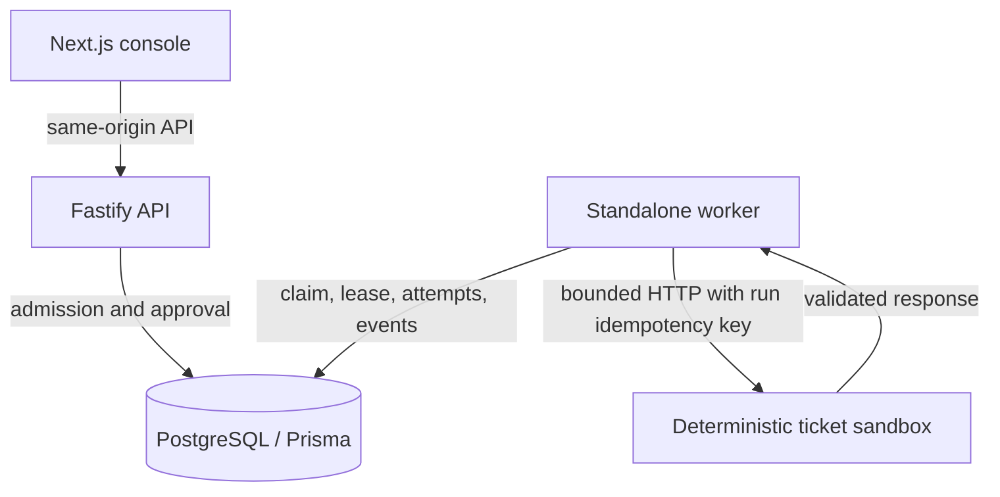
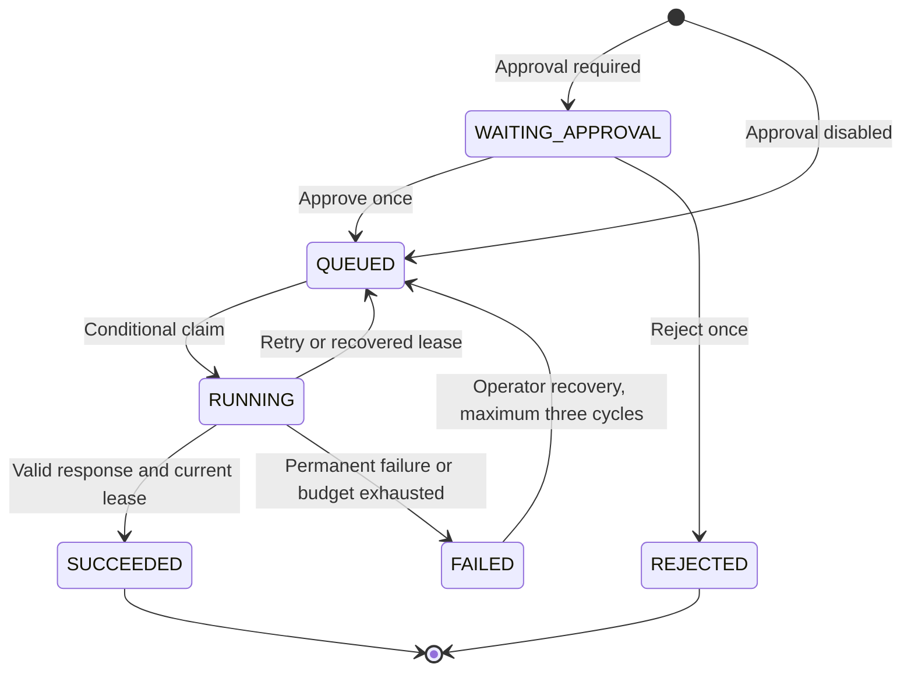

# Architecture

The UI uses a same-origin `/api/*` rewrite. Fastify owns validation and authorization. PostgreSQL persists users, sessions, versioned workflows, run snapshots, approval decisions, attempts, and events. The browser does not command a worker directly.

## Durable boundaries

A session stores a SHA-256 digest of the random cookie, a CSRF token, and expiry. Role claims come from the database. Workflow/run reads and mutations include owner predicates. This is per-user ownership, not collaborative organization tenancy.

A run snapshots its configuration and version at admission. Editing/archiving the source workflow cannot alter that snapshot. The unique `(ownerId, idempotencyKey)` index and a content hash define admission. `INSERT ... ON CONFLICT DO NOTHING` through Prisma `createMany(skipDuplicates)` and the admission event share a transaction.

A worker selects a candidate and conditionally changes `QUEUED` to `RUNNING`. The same transaction increments counters, assigns ownership, and writes the attempt/event. A result commits only with matching status/token and an unexpired lease. Lease duration is HTTP timeout + five seconds. Expired ownership is reaped transactionally; stale workers cannot commit. The worker runs one request at a time and exposes a loopback health endpoint.

The remote idempotency key remains the run ID across retries/recovery. The sandbox deduplicates cached and in-flight requests while its process is alive. It is not a general exactly-once guarantee; its cache is not durable across restart.

## Integration and storage

The integration URL is server configuration. User input cannot choose hosts; redirects are rejected. Abort deadlines bound the request. A streaming read caps output at 16 KiB before JSON parsing and Zod validation. Upstream bodies are not reflected into error messages.

`Attempt` has unique `(runId, number)`. `RunEvent` records decisions, execution, retries, outcomes, lease expiry, and recovery. These transactional records remain editable by database administrators; they are not an immutable ledger.

SQL migrations enforce foreign keys, uniqueness, attempt/timeout bounds, lease-state consistency, successful output, and approval gating. Native PostgreSQL is the standard/CI runtime. Local evidence separately identifies the PostgreSQL WASM/PGlite fallback and its different concurrency semantics.
